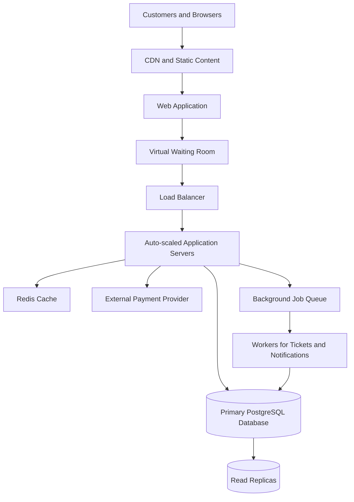

# Day 8 Assignment: TicketHub System Design

## 1. Requirements

TicketHub is a website where customers discover concerts and events, select seats, purchase tickets, and view their orders.

### 1.1 Functional Requirements

- Users can register, log in, and manage their accounts.
- Users can browse upcoming events and view event details, dates, venues, and prices.
- Users can view a seat map showing which seats are available, held, or sold.
- Authenticated users can temporarily hold available seats while completing checkout.
- Users can create orders and pay through an external payment provider.
- Users can view their purchased tickets and order history.
- The system automatically releases expired seat holds so other customers can purchase those seats.
- Users receive order and payment confirmation after a purchase is successfully completed.
- The system prevents two customers from purchasing the same seat.
- The system safely handles repeated requests caused by network errors, page refreshes, or payment-provider retries.

### 1.2 Non-Functional Requirements

**Performance:** Under normal traffic, most event-page and browsing requests should respond within approximately 500 milliseconds. During a popular sale, the system should maintain responsive browsing and provide clear feedback if checkout requests must wait.

**Scalability:** The system must support 2 million registered users, 50,000 daily visitors, and sudden traffic increases when popular concerts go on sale.

**Correctness and consistency:** Each physical seat can have only one active hold at a time and can be sold only once. Orders, seat assignments, and payment records must remain consistent even when several customers act simultaneously.

**Fairness:** The system should use a transparent waiting room or queue during major sales, communicate customers' waiting status, apply reasonable rate limits, and prevent automated clients from overwhelming the service. A queue must not guarantee a seat before the database confirms a successful hold.

**Availability and reliability:** The website should continue serving browsing requests during traffic spikes. If a service fails, the system should recover safely without issuing duplicate tickets or losing track of payments.

**Security and privacy:** Users must authenticate before purchasing tickets or accessing private orders. Passwords must be stored as secure hashes. Payment card details should be handled by a trusted payment provider, not stored directly by TicketHub.

**Maintainability and monitoring:** The system should log important events and monitor response times, failed requests, database load, queue length, seat-hold conflicts, and payment failures.

## 2. Traffic Estimates

The following estimates use the assignment's figures and explicitly stated assumptions. Actual production traffic may vary, especially during the first seconds of a major ticket release.

### 2.1 Normal Daily Traffic

Given:

- Registered users: 2,000,000.
- Daily visitors: 50,000.
- Pages viewed per visitor: 10.
- Tickets sold per day: 5,000.

**Daily page views**

50,000 visitors × 10 pages = 500,000 page views per day.

**Average page views per second**

500,000 ÷ 86,400 seconds ≈ 5.8 page views per second.

For planning purposes, assume a busy period reaches ten times the daily average:

5.8 × 10 ≈ 58 page views per second.

This is a planning assumption, not a measured peak. Actual traffic could be higher or lower.

**Average ticket sales**

5,000 tickets ÷ 86,400 seconds ≈ 0.058 tickets per second.

This average does not mean tickets are sold evenly throughout the day. Ticket sales may be concentrated around specific event releases.

### 2.2 Popular Concert Sale

Given:

- 200,000 people attempt to buy tickets.
- The concert has 20,000 seats.
- The initial sale period is 10 minutes, or 600 seconds.

**Average customer arrival rate**

200,000 ÷ 600 ≈ 333 customer attempts per second.

**Competition for seats**

200,000 customers ÷ 20,000 seats = 10 customers per seat.

If every customer wants one seat and all seats are sold, only 20,000 of the 200,000 customers can obtain a seat. That is 10% of the interested customers.

**Estimated API request rate**

For capacity planning, assume each customer generates five requests during the sale, including event viewing, seat-map viewing, a hold attempt, checkout, and order confirmation.

Total estimated requests:

200,000 customers × 5 requests = 1,000,000 requests.

Average request rate across the ten-minute period:

1,000,000 ÷ 600 ≈ 1,667 requests per second.

This estimate assumes five requests per customer. It does not include additional retries or requests from automated clients, and the instantaneous peak could be much higher than the average.

### 2.3 Comparison

| Metric                           | Normal day                 | Popular concert sale                                 |
| -------------------------------- | -------------------------- | ---------------------------------------------------- |
| Registered users                 | 2,000,000                  | 2,000,000                                            |
| Visitors or interested customers | 50,000 per day             | 200,000 in 10 minutes                                |
| Estimated page views or requests | 500,000 page views per day | 1,000,000 requests in 10 minutes                     |
| Average estimated request rate   | 5.8 page views/second      | 1,667 requests/second                                |
| Planning busy-period rate        | 58 page views/second       | Instantaneous peak may exceed the ten-minute average |
| Ticket sales or available seats  | 5,000 tickets sold per day | 20,000 seats available                               |

The estimated popular-sale rate of 1,667 requests per second is approximately 287 times the normal daily average of 5.8 page views per second.

Compared with the assumed normal busy-period rate of 58 page views per second, the popular-sale average is approximately 29 times higher.

The system must therefore prepare for a sharp increase in demand. A waiting room, caching, horizontal scaling, and database-level seat protection help manage this demand without sacrificing purchase correctness.

## 3. API Design

TicketHub exposes a REST-style API. Requests and responses use JSON where a body is required. Authentication is required for private account and purchasing operations.

### 3.1 Browse Events

- **Method:** GET
- **Endpoint:** `/api/events`
- **Purpose:** Returns a paginated list of upcoming events.
- **Response:** Event IDs, names, dates, venues, and starting prices.
- **Authentication:** Not required for public events.

### 3.2 View Event Details

- **Method:** GET
- **Endpoint:** `/api/events/{eventId}`
- **Purpose:** Returns the details of one event, including its venue, date, and ticket information.
- **Response:** Event details and current sale status.

### 3.3 View Seats

- **Method:** GET
- **Endpoint:** `/api/events/{eventId}/seats`
- **Purpose:** Returns the seat map and the displayed status of each seat.
- **Response:** Seat IDs, labels, prices, and availability states such as AVAILABLE, HELD, and SOLD.

Seat availability in this response is informational only. A seat can be held by another customer immediately after the response is returned. The server must check availability again when processing a hold request.

### 3.4 Hold Seats

- **Method:** POST
- **Endpoint:** `/api/events/{eventId}/holds`
- **Purpose:** Attempts to hold one or more available seats for an authenticated customer.
- **Example request:**

```json
{
  "seatIds": [101, 102]
}
```

- **Successful response:** A hold ID, the held seat IDs, and the expiry timestamp.
- **Failure response:** HTTP 409 Conflict if one or more requested seats cannot be held.

The server must hold all requested seats successfully or roll back the operation. It must not create a partial hold if the customer requested all seats together.

### 3.5 Create an Order

- **Method:** POST
- **Endpoint:** `/api/orders`
- **Purpose:** Creates a pending order associated with a valid hold.
- **Example request:**

```json
{
  "holdId": "hold-123",
  "idempotencyKey": "checkout-request-456"
}
```

- **Successful response:** The order ID, total amount, and current order status.

The server validates the hold and calculates the price. It does not trust a total price supplied by the client. The idempotency key prevents repeated checkout requests from creating duplicate orders.

### 3.6 Pay for an Order

- **Method:** POST
- **Endpoint:** `/api/orders/{orderId}/payments`
- **Purpose:** Initiates payment through an external payment provider.
- **Response:** A payment reference and current payment status.

The server verifies payment results with the provider before finalizing the purchase. Repeated requests must be handled idempotently so that a retry does not charge the customer twice.

### 3.7 View My Tickets

- **Method:** GET
- **Endpoint:** `/api/me/tickets`
- **Purpose:** Returns the authenticated customer's purchased tickets.
- **Security:** Customers can only view their own tickets.

### 3.8 View an Order

- **Method:** GET
- **Endpoint:** `/api/orders/{orderId}`
- **Purpose:** Returns the order details and payment status.
- **Security:** The server verifies that the authenticated customer owns the order.

## 4. Data Model

TicketHub uses PostgreSQL, a relational database that supports transactions, foreign keys, unique constraints, and concurrent updates.

### 4.1 Users

| Column         | Purpose                    |
| -------------- | -------------------------- |
| id (PK)        | Unique user identifier     |
| name           | Customer name              |
| email (UNIQUE) | Login and contact email    |
| password_hash  | Secure password hash       |
| created_at     | Account creation timestamp |

### 4.2 Events

| Column     | Purpose                     |
| ---------- | --------------------------- |
| id (PK)    | Unique event identifier     |
| name       | Concert or event name       |
| venue      | Event venue                 |
| event_date | Date and time of the event  |
| status     | DRAFT, ON_SALE, or SOLD_OUT |

### 4.3 Seats

Each row represents one physical seat for a specific event.

| Column                         | Purpose                               |
| ------------------------------ | ------------------------------------- |
| id (PK)                        | Unique seat identifier                |
| event_id (FK)                  | References Events.id                  |
| seat_number                    | Seat label within the event           |
| status                         | AVAILABLE, HELD, or SOLD              |
| hold_expires_at                | Expiry timestamp for a temporary hold |
| held_by_user_id (FK, nullable) | User currently holding the seat       |

Constraints:

- `UNIQUE(event_id, seat_number)` prevents the same physical seat from being entered more than once for an event.
- A foreign key on `event_id` ensures that every seat belongs to a valid event.
- The hold owner should be populated only while the seat is held.

### 4.4 Orders

| Column          | Purpose                                       |
| --------------- | --------------------------------------------- |
| id (PK)         | Unique order identifier                       |
| user_id (FK)    | References Users.id                           |
| status          | PENDING, PAID, FAILED, or EXPIRED             |
| total_amount    | Total order amount                            |
| idempotency_key | Unique checkout retry key, scoped to the user |
| created_at      | Order creation timestamp                      |

The idempotency key should have a uniqueness constraint scoped to the user or checkout operation. A repeated request with the same key should return the original order result rather than create another order.

### 4.5 Order_Items

Each row represents a seat assigned to a finalized ticket purchase.

| Column        | Purpose                            |
| ------------- | ---------------------------------- |
| id (PK)       | Unique order-item identifier       |
| order_id (FK) | References Orders.id               |
| seat_id (FK)  | References Seats.id                |
| price         | Price of the seat at purchase time |

A unique constraint on `seat_id` prevents the same seat from being assigned to two permanent ticket records.

Only finalized ticket purchases should create permanent order items. Failed or cancelled orders must not leave a permanent seat assignment that prevents legitimate resale. The seat must also be changed to SOLD in the same database transaction that records the finalized order item.

### 4.6 Payments

| Column                      | Purpose                                  |
| --------------------------- | ---------------------------------------- |
| id (PK)                     | Unique payment-attempt identifier        |
| order_id (FK)               | References Orders.id                     |
| provider_reference (UNIQUE) | Payment provider's transaction reference |
| status                      | PENDING, SUCCEEDED, or FAILED            |
| amount                      | Amount requested or paid                 |
| created_at                  | Payment-attempt timestamp                |

An order may have more than one payment attempt, but a successful payment must not result in duplicate charges or duplicate tickets. Payment attempts should use idempotency controls and be reconciled against the provider's records.

TicketHub stores payment references and statuses, not raw card details.

### 4.7 Relationships

- One user can have many orders.
- One event can have many seats.
- One order can contain many order items.
- Each order item references one seat.
- Each seat belongs to one event.
- One user can temporarily hold multiple seats.
- One order can have multiple payment attempts.
- Foreign keys protect relationships between records.

The database constraints provide a final safeguard even when several application servers process requests concurrently.

## 5. Preventing Double-Booking

The main correctness requirement is that two customers must never purchase the same physical seat.

TicketHub combines conditional database updates, transactions, temporary holds, and uniqueness constraints. The database—not the browser, cache, or waiting room—is the final authority for seat ownership.

### 5.1 Atomically Hold an Available Seat

When a customer requests a seat, the server starts a database transaction and attempts a conditional update:

```sql
UPDATE seats
SET status = 'HELD',
    held_by_user_id = :user_id,
    hold_expires_at = :expiry
WHERE id = :seat_id
  AND status = 'AVAILABLE';
```

The application checks the number of affected rows.

- If one row is updated, the seat was successfully held.
- If zero rows are updated, the seat was not available, so the request fails with a conflict response.

When two customers try to hold the same seat, the database processes the conditional updates so that only one customer can successfully change the seat from AVAILABLE to HELD. The other customer's update affects zero rows and receives a 409 Conflict response.

For a request containing multiple seats, TicketHub must verify that every requested seat was successfully held. If any seat cannot be held, the transaction is rolled back so that the customer does not receive only part of the requested hold.

### 5.2 Handling Expired Holds

A hold is valid for 10 minutes. When the expiry time passes, the system must allow another customer to hold the seat.

The server can release expired holds using a background worker or check and reclaim an expired hold during a new hold request. A seat should only be reclaimed if its hold has expired and it has not been sold.

The database must perform the status and expiry checks atomically. This prevents a background worker from releasing a seat that has already been sold or legitimately held again.

### 5.3 Finalizing a Purchase

After the payment provider confirms successful payment, TicketHub must verify that the order and its holds are still valid. It then uses a database transaction to mark the seats as SOLD, record the finalized order items, and update the order and payment statuses.

These database changes must succeed together. If the transaction fails, TicketHub must not issue duplicate tickets. The payment result must be reconciled with the payment provider, and the system must safely retry or investigate the incomplete purchase.

Payment-provider requests should not be held inside a long-running database transaction. Idempotency keys and provider transaction references help prevent duplicate charges when requests are retried.

### 5.4 Why This Prevents Double-Booking

The conditional database update checks and changes seat availability as one atomic operation. Even if many application servers process requests simultaneously, only one can successfully claim a seat that is available.

The unique constraint on `Order_Items.seat_id` adds a second layer of protection against assigning the same seat to two finalized ticket records.

The waiting room reduces pressure on the application, and the cache speeds up browsing, but neither guarantees ownership. The database transaction and constraints enforce the final decision.

## 6. System Architecture



### 6.1 Architecture Components

- **CDN:** Serves static files, images, and other reusable content close to customers. This reduces the number of requests reaching the application servers.
- **Virtual waiting room:** During a popular sale, customers enter a queue. The system admits them at a controlled rate to reduce overload and support fair access.
- **Load balancer:** Distributes incoming requests across application servers.
- **Auto-scaled application servers:** Additional stateless servers can be started to handle increased demand. Every server uses the same database rules for seat reservations.
- **Redis cache:** Stores suitable browsing data, such as event details and short-lived seat-map information. Cached availability is not authoritative; the database always performs the final hold check.
- **Primary PostgreSQL database:** Stores seat statuses, holds, orders, and finalized purchases. Transactions and database constraints protect correctness.
- **Read replicas:** Handle suitable read-only browsing and search queries to reduce load on the primary database. Replication delays must be considered because a replica may show stale information.
- **External payment provider:** Processes payments without TicketHub storing raw card details.
- **Background job queue and workers:** Generate ticket documents, send confirmation emails, and process expired holds. These tasks run outside the main checkout request where appropriate.

### 6.2 Handling the Traffic Spike

The popular-sale estimate is approximately 1,667 requests per second averaged across ten minutes, although actual peaks may be much higher.

TicketHub can prepare additional application capacity before a scheduled sale, serve static content through the CDN, cache appropriate browsing data, and use the waiting room to control admission.

The system should monitor queue length, response times, database load, failed hold requests, and payment errors. Capacity limits should be based on load testing rather than assuming that a particular number of application servers can handle the sale.

Most importantly, the waiting room and cache reduce unnecessary load, while the primary database remains responsible for deciding who successfully holds and purchases each seat.

## 7. Design Trade-offs

### 7.1 Correctness vs. Availability

TicketHub prioritizes correct seat ownership over accepting every purchase request immediately. If the primary database cannot confirm a hold, the system should wait, retry safely, or return a clear error rather than risk selling the same seat twice.

### 7.2 Freshness vs. Performance

Caching seat maps improves response times, especially during a major sale. However, a cached seat may appear available after another customer has held it. TicketHub accepts this limitation because the database checks availability again before granting the hold.

### 7.3 Fairness vs. Simplicity

A virtual waiting room adds infrastructure and operational complexity. However, it helps control traffic, discourages excessive refreshing, and gives the system a way to admit customers in a controlled order. Queue position does not guarantee a ticket because seat availability must still be confirmed.

### 7.4 Short Holds vs. Payment Reliability

A 10-minute hold gives customers time to complete checkout without reserving seats indefinitely. However, payment delays can cause holds to expire. TicketHub needs clear expiry rules, idempotent payment handling, and payment reconciliation so that a delayed response does not result in duplicate charges or incorrectly issued tickets.

## 8. Conclusion

TicketHub must support ordinary event browsing as well as sudden, intense demand during popular ticket releases. Caching, a CDN, a waiting room, load balancing, and horizontally scalable application servers help the system handle this demand.

The central design principle is that the database guarantees seat ownership. Conditional updates, transactions, foreign keys, and unique constraints prevent duplicate seat assignments. Idempotent checkout and payment reconciliation further protect customers when requests fail or are repeated.

This approach balances performance, fairness, reliability, and correctness while allowing TicketHub to scale for major concert sales.
